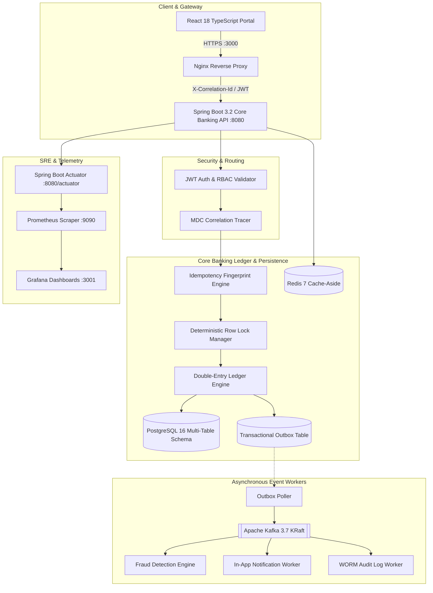

# Digital Banking & FinTech Platform

> [!CAUTION]
> **EDUCATIONAL SIMULATION DISCLAIMER**
> This repository is an **educational FinTech software simulation** designed for engineering research, distributed systems architecture study, and full-stack development demonstrations. It is **NOT** a real banking product and does not hold banking licenses, regulatory compliance certifications (e.g. PCI-DSS, SOC2, RBI, Federal Reserve), or financial guarantees. Do not use this software for live financial transactions.

---

## 1. Project Overview

The **Digital Banking & FinTech Platform** is a distributed financial software system built on Java 21, Spring Boot 3.2, PostgreSQL 16, Redis 7, Apache Kafka 3.7 (KRaft), and React 18 with TypeScript. 

It provides an immutable **Double-Entry General Ledger Engine**, cryptographic request idempotency, transactional outbox event streaming, real-time fraud scoring, Write-Once-Read-Many (WORM) audit logging, and modern customer/admin portals.

---

## 2. The Problem & Solution

### The Challenge in Financial Engineering
Traditional monolithic applications often suffer from:
- **Dual-Write Anomalies**: Database commits succeed but message broker publishes fail, causing out-of-sync distributed states.
- **Rounding & Precision Errors**: Floating-point mathematics leaking fractional pennies.
- **Race Conditions & Double-Spending**: Concurrent transfer submissions causing negative account balances or deadlocks.
- **Replay Vulnerabilities**: Network retries causing duplicate funds transfers.

### The Engineering Solution
1. **Mathematical Ledger Conservation**: Double-entry ledger architecture enforcing $\sum \text{Debits} == \sum \text{Credits}$ with `NUMERIC(19, 4)` precision.
2. **Transactional Outbox Pattern**: Atomic database writes for both ledger entries and domain events, paired with an asynchronous poller providing At-Least-Once Kafka streaming.
3. **Deterministic Row Locking**: Account locks ordered by natural UUIDs (`min(A, B)` then `max(A, B)`), mathematically eliminating database deadlocks.
4. **Cryptographic Idempotency State Machine**: Client `X-Idempotency-Key` and SHA-256 fingerprint validation to cache and return identical receipts in $< 5\text{ms}$.

---

## 3. Architecture Overview



---

## 4. Key Platform Features

- **Double-Entry General Ledger**: Immutable journal entries and transaction legs with running balances.
- **Account Management**: Support for Checking and Savings accounts with active/frozen lifecycle controls.
- **Beneficiary Management**: Secure validation and management of transfer recipients.
- **Transactional Outbox**: Guaranteed Kafka event delivery without dual-write hazards.
- **Real-Time Fraud Detection Engine**: Multi-heuristic rule evaluations (large transaction velocity, round-amount structuring, rapid repeat transfers).
- **WORM Audit Trail**: Write-Once-Read-Many regulatory audit logging with actor IDs and IP addresses.
- **Full-Stack React Portal**: 14 modular responsive interfaces for customers and bank administrators.
- **Enterprise Observability**: Prometheus metrics, custom Micrometer telemetry, Actuator health probes, and Grafana dashboards.

---

## 5. Technology Stack

| Layer | Technology |
| :--- | :--- |
| **Backend Core** | Java 21, Spring Boot 3.2.4, Spring Security 6, Spring Data JPA, Hibernate 6 |
| **Frontend Portal** | React 18, TypeScript 5, Vite, TanStack Query v5, Tailwind CSS, Lucide Icons, Axios |
| **Database & Schema** | PostgreSQL 16, Flyway Migrations |
| **In-Memory Cache** | Redis 7 (Cache-Aside with proactive invalidations) |
| **Event Streaming** | Apache Kafka 3.7.0 (KRaft Mode, Zero Zookeeper dependency) |
| **Observability** | Spring Boot Actuator, Micrometer, Prometheus, Grafana 10.4 |
| **Testing** | JUnit 5, Mockito, Spring Boot Test, JaCoCo ($\ge 80\%$ Coverage Gate) |
| **DevOps & Containers** | Multi-Stage Dockerfiles, Docker Compose, GitHub Actions CI/CD |

---

## 6. Project Structure

```
.
├── .github/
│   ├── workflows/
│   │   ├── ci.yml                 # PR & Push CI pipeline (Tests + Coverage + Lint)
│   │   ├── docker-publish.yml     # Multi-stage Docker build, Trivy scan & GHCR push
│   │   └── cd-deploy.yml          # Staging/Prod zero-downtime CD with approval gates
│   └── dependabot.yml             # Automated weekly package updates
├── docker/
│   ├── prometheus/                # Prometheus scrape configurations
│   └── grafana/                   # Auto-provisioned SRE dashboards & datasources
├── docs/
│   ├── ARCHITECTURE.md            # In-depth system architecture & decomposition
│   ├── DATABASE.md                # ERD, Flyway schemas & ledger invariants
│   ├── API.md                     # Complete REST API specification
│   ├── SECURITY.md                # JWT rotation, RBAC & cryptographic governance
│   ├── KAFKA.md                   # Topics, event envelopes & consumer groups
│   ├── DEPLOYMENT.md              # Docker & infrastructure deployment guide
│   ├── TESTING.md                 # 10-layer test pyramid & coverage verification
│   ├── TROUBLESHOOTING.md         # Operational runbook & incident diagnosis
│   └── DEVELOPMENT_SETUP.md       # Local developer onboarding guide
├── frontend/                      # React 18 TypeScript Vite Application
│   ├── src/
│   │   ├── api/                   # Axios client with 401 refresh token queue
│   │   ├── components/            # UI components, modals & layout navigation
│   │   ├── context/               # Auth & Notification React Contexts
│   │   └── pages/                 # 14 Customer, Admin, and Public pages
│   ├── Dockerfile                 # Multi-stage frontend container build
│   └── nginx.conf                 # Edge reverse proxy & SPA router
├── src/                           # Spring Boot 3.2 Java 21 Core Banking
│   ├── main/
│   │   ├── java/com/fintech/bank/ # Controllers, Services, Entities, Repositories
│   │   └── resources/             # Flyway SQL migrations, application YAMLs
│   └── test/                      # 29 test suites across 10 architectural layers
├── docker-compose.yml             # 7-container local topology
├── Dockerfile                     # Multi-stage backend container build
└── pom.xml                        # Maven dependencies & JaCoCo configuration
```

---

## 7. Quick Start: Running Locally with Docker

### Prerequisites
- Docker Engine 24+ & Docker Compose v2+

### One-Line Launch
```bash
# 1. Clone repository
git clone https://github.com/Mallukodanda/Digital-banking-Fintech-Platform.git
cd Digital-banking-Fintech-Platform

# 2. Copy environment template
cp .env.example .env

# 3. Build and start all 7 containers
docker compose up --build -d
```

### Accessing the System

| Application | URL | Default Credentials |
| :--- | :--- | :--- |
| **Banking Portal** | `http://localhost:3000` | Customer: `customer@bank.com` / `Customer@123`<br/>Admin: `admin@bank.com` / `Admin@123` |
| **Swagger API Docs** | `http://localhost:8080/swagger-ui.html` | N/A (Public API documentation) |
| **Actuator Health** | `http://localhost:8080/actuator/health` | Subsystem status probes |
| **Prometheus** | `http://localhost:9090` | Time-series query interface |
| **Grafana Dashboards**| `http://localhost:3001` | User: `admin` / Password: `admin_observability_2026` |

---

## 8. Running Tests & Quality Verification

```bash
# Execute all 29 test suites across 10 layers
mvn clean test

# Run JaCoCo coverage analysis (enforces >= 80% instruction coverage)
mvn jacoco:report jacoco:check
```

---

## 9. Limitations & Future Enhancements

### Current Educational Limitations
- **Single-Currency Engine**: Default ledger operations use standard internal base currency (`INR`). Multi-currency FX conversion with real-time rate feeds is a future milestone.
- **Simulated Notifications**: Notifications are persisted for in-app display; external SMS/Email gateways are mocked.

### Future Roadmap
- **Open Banking & PSD2 Compliance**: Open banking REST APIs with OAuth2 mTLS consent management.
- **AI-Driven Anomaly Detection**: Graph neural network (GNN) model integration for fraud ring detection.
- **Cross-Border FX Clearing**: Multi-currency nostro/vostro ledger accounts.

---

## 10. License
This project is open-source under the MIT License.
