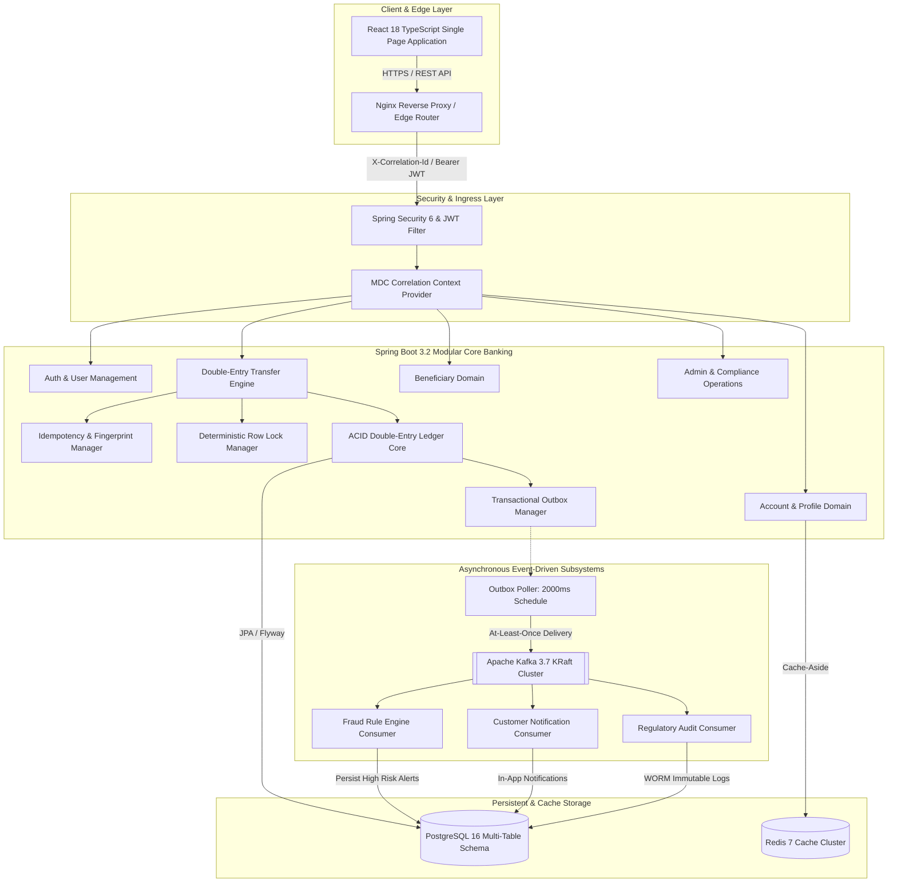

# System Architecture Documentation

## 1. High-Level Architectural Overview

The **Digital Banking & FinTech Platform** is designed as a **Modular Monolith transitioning to Event-Driven Microservices** with strict double-entry ledger invariants, asynchronous event streaming via Kafka, in-memory caching via Redis, and a modern React TypeScript frontend portal.

---

## 2. Core Architectural Pillars

### A. Double-Entry General Ledger Engine
- Every monetary operation records a balancing **Journal Entry** with at least one **DEBIT** leg and one **CREDIT** leg.
- Strictly adheres to the zero-sum ledger conservation invariant:
  $$\sum \text{Debit Amounts} == \sum \text{Credit Amounts}$$
- All monetary amounts use `NUMERIC(19, 4)` with `BigDecimal` arithmetic, completely eliminating floating-point rounding errors.

### B. Transactional Outbox Pattern
- Solves the distributed dual-write hazard without distributed two-phase commit (2PC).
- When a funds transfer executes, the `JournalEntry`, `TransactionLeg` records, and `OutboxEvent` are written to PostgreSQL inside the **same atomic database transaction**.
- An asynchronous poller reads `PENDING` outbox events, dispatches them to Kafka, and marks them `PUBLISHED`.

### C. Deterministic Concurrency & Lock Ordering
- Eliminates database deadlocks during concurrent multi-party transfers by sorting account IDs prior to acquiring `PESSIMISTIC_WRITE` locks:
  $$\text{FirstLock} = \min(\text{ID}_A, \text{ID}_B), \quad \text{SecondLock} = \max(\text{ID}_A, \text{ID}_B)$$

### D. Cryptographic Idempotency Engine
- Enforces an `X-Idempotency-Key` header on all mutating financial endpoints.
- SHA-256 fingerprints the HTTP method, endpoint path, authenticated user ID, and JSON request body.
- Replays of completed transactions return cached response receipts in $< 5\text{ms}$ without re-executing ledger operations.

### E. Microservices Decomposition Strategy (Strangler Fig)
1. **Core Banking Monolith**: Manages accounts, balances, and double-entry ledger transactions (preserves single-database ACID guarantees).
2. **Extracted Microservices**: Asynchronous, event-driven workers for **Fraud Detection**, **Notifications**, and **Audit Logs** communicate strictly via Kafka topics.
