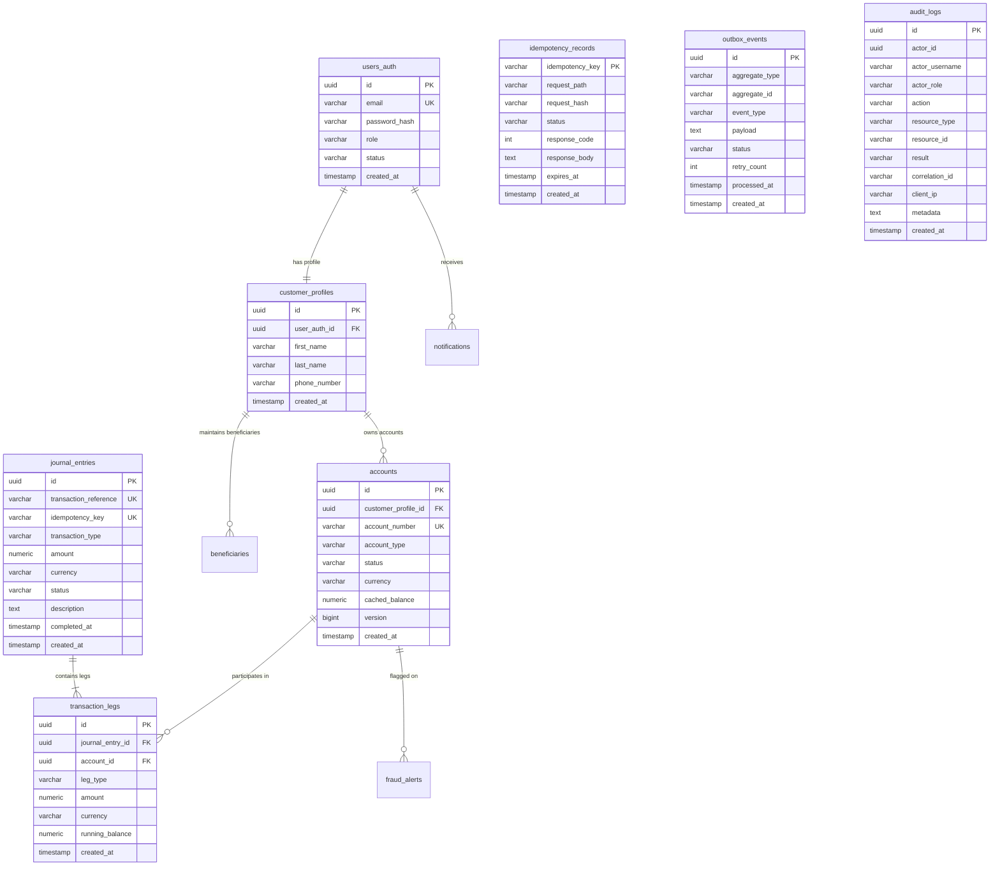

# Database Architecture & Schema Documentation

## 1. Database Overview

The platform uses **PostgreSQL 16** managed via **Flyway Schema Migrations**. The database enforces strict ACID guarantees, foreign key constraints, high-performance B-tree indexes, and table-level constraints for financial data integrity.

---

## 2. Table Catalog & Financial Invariants

### A. `journal_entries` & `transaction_legs`
- **Zero-Sum Ledger Guarantee**: Every row in `journal_entries` has at least two associated rows in `transaction_legs` (one `DEBIT`, one `CREDIT`).
- **Precision**: All amounts use `NUMERIC(19, 4)` to store monetary values to four decimal places.
- **Indexes**:
  - `idx_journal_entries_reference` on `transaction_reference` (Unique B-tree).
  - `idx_journal_entries_idempotency` on `idempotency_key` (Unique B-tree).
  - `idx_transaction_legs_account_created` on `(account_id, created_at DESC)` for high-speed paginated statement queries.

### B. `accounts`
- **Optimistic Concurrency**: Uses `@Version` column (`bigint version`) to guard against lost updates in concurrent scenarios.
- **Pessimistic Locking**: Core transfer operations lock account rows using `SELECT ... FOR UPDATE` in deterministic sorted order.
- **Balance Cache**: `cached_balance` is updated atomically within the transaction and verified against ledger sum.

### C. `outbox_events`
- Stores serialized JSON payloads of domain events (`TRANSFER_COMPLETED`, `ACCOUNT_CREATED`, `FRAUD_ALERT_GENERATED`).
- Index: `idx_outbox_events_pending` on `(status, created_at)` for $< 1\text{ms}$ polling queries by the background worker.

### D. `idempotency_records`
- Enforces distributed locking for in-flight requests (`PROCESSING`) and caches the completed response (`COMPLETED`).
- TTL Cleanup: Records expire after 24 hours (`expires_at`).

### E. `audit_logs`
- Write-Once-Read-Many (**WORM**) append-only compliance trail.
- Indexes on `actor_id`, `action`, `correlation_id`, and `created_at` enable flexible JPA criteria query filtering for compliance audits.
