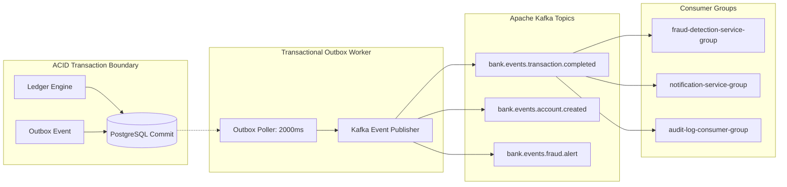

# Event Streaming & Apache Kafka Architecture

## 1. Event-Driven Architecture Overview

The platform uses **Apache Kafka 3.7 (KRaft mode)** for asynchronous, decoupled event streaming between the core banking ledger and downstream consumer microservices.



---

## 2. Kafka Topics Catalog

| Topic Name | Key Format | Payload Type | Description |
| :--- | :--- | :--- | :--- |
| `bank.events.transaction.completed` | `sourceAccountId` (UUID) | `DomainEvent<TransactionCompletedEventPayload>` | Emitted upon successful double-entry ledger execution. |
| `bank.events.account.created` | `accountId` (UUID) | `DomainEvent<AccountCreatedEventPayload>` | Emitted when a new checking/savings account is provisioned. |
| `bank.events.fraud.alert` | `alertId` (UUID) | `DomainEvent<FraudAlertEventPayload>` | Emitted when the fraud engine detects high-risk transactions. |

---

## 3. Domain Event Envelope Specification

All domain events adhere to a versioned standard envelope:
```json
{
  "eventId": "e9b28a1c-5d3e-4b2a-9f1e-8a7b6c5d4e3f",
  "eventType": "TRANSFER_COMPLETED",
  "aggregateType": "TRANSFER",
  "aggregateId": "a1b2c3d4-0000-0000-0000-000000000001",
  "version": 1,
  "timestamp": "2026-10-08T18:45:00.123Z",
  "correlationId": "corr-9f82a1b4-7c3e",
  "payload": {
    "transactionId": "f9e8d7c6-0000-0000-0000-000000000099",
    "transactionReference": "TXN-1712567890-A8F2BC1D",
    "idempotencyKey": "idemp-uuid-123",
    "transactionType": "P2P_TRANSFER",
    "sourceAccountId": "a1b2c3d4-0000-0000-0000-000000000001",
    "sourceAccountNumber": "100000000001",
    "destinationAccountId": "b2c3d4e5-0000-0000-0000-000000000002",
    "destinationAccountNumber": "100000000002",
    "amount": 25000.00,
    "currency": "INR",
    "status": "COMPLETED",
    "description": "Invoice Payment #104",
    "completedAt": "2026-10-08T18:45:00Z"
  }
}
```

---

## 4. Consumer Invariants & Deduplication

- **Idempotent Consumers**: Downstream consumers (e.g. `NotificationService`) check `existsByRecipientUserIdAndEventId(userId, eventId)` before writing notifications, ensuring duplicate deliveries are safely ignored.
- **Partition Alignment**: `partitionKey` is set to `sourceAccountId` to guarantee strict in-order processing for transactions originating from the same account.
